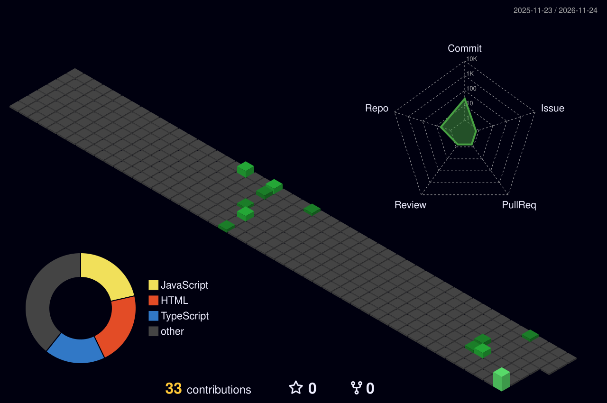

<p align="center">
  <a href="https://github.com/mohamedelnady99">
    
  </a>
</p>

<p align="center">
  <a href="https://www.linkedin.com/in/mohamed-nasr-elnady/"></a>
  <a href="https://wa.me/201155075584"></a>
  <a href="https://github.com/mohamedelnady99"></a>
  
</p>

---

## 🧠 About me

I design and build **software and AI solutions for companies**: AI agents that automate real work, RAG systems that answer from a company's own data, and the full-stack platforms around them, from the database and APIs to the interface.

```python
class SoftwareEngineer:
    principles = ["OOP", "Clean Architecture", "SOLID", "Design Patterns"]


class MohamedNasr(SoftwareEngineer):
    title      = "AI Solutions Engineer"
    experience = "2+ years shipping production software"
    languages  = ["Python", "Java", "TypeScript", "JavaScript", "PHP"]
    ai         = ["AI Agents", "RAG Systems", "LLM APIs", "Workflow Automation"]
    backend    = ["FastAPI", "Node.js", "Express", "Laravel"]
    frontend   = ["React", "Next.js", "React Native"]
    location   = "Cairo, Egypt 🇪🇬  ·  Remote-friendly 🌍"

    def solve(self, business_problem):
        return self.design() >> self.build() >> self.ship()
```

## 💼 What I deliver

<table>
  <tr>
    <td width="50%" valign="top">
      <h3>🤖 AI Agents & Automation</h3>
      <p>Agents that use tools and APIs to run business workflows: support, sales follow-ups, reporting and internal operations.</p>
      <p><code>Python</code> <code>LLM APIs</code> <code>Tool calling</code> <code>n8n</code></p>
    </td>
    <td width="50%" valign="top">
      <h3>📚 RAG Knowledge Systems</h3>
      <p>Assistants that answer from a company's documents and databases, with cited sources and access control.</p>
      <p><code>Python</code> <code>FastAPI</code> <code>pgvector</code> <code>LangChain</code></p>
    </td>
  </tr>
  <tr>
    <td width="50%" valign="top">
      <h3>🧩 Full-Stack Platforms</h3>
      <p>SaaS products, e-commerce and dashboards: scalable APIs, clean databases and fast bilingual (AR/EN) interfaces.</p>
      <p><code>Next.js</code> <code>Node.js</code> <code>Laravel</code> <code>PostgreSQL</code></p>
    </td>
    <td width="50%" valign="top">
      <h3>🏢 ERP Solutions</h3>
      <p>Odoo implementation and customization across Accounting, Sales & CRM, Inventory, Purchase and HR.</p>
      <p><code>Odoo</code> <code>Python</code> <code>PostgreSQL</code></p>
    </td>
  </tr>
</table>

## 🚀 Delivered projects

| Project | What I built | Stack |
|---|---|---|
| 📚 **Mahabba Book Store** | Production e-commerce: storefront, admin panel and API, with separate staging and production environments | Next.js · Laravel · MySQL |
| ✨ **Laser Gallery** | E-commerce for laser-crafted products with online payments (Paymob) and shipping (Bosta) integrations | React · Laravel · REST APIs |
| 🏠 **Maskan** | Housing rental platform: one API serving mobile and web, admin review workflow, search and filters, AR/EN | Laravel · MySQL · REST APIs |
| 🛒 **TIJORA** | SaaS combining online stores and SMM panels: multi-tenant dashboards with workspaces and members | React · TypeScript · Tailwind |
| 🏢 **Divlix** | Bilingual company website with motion design and RTL/LTR support | Next.js 15 · TypeScript · Framer Motion |
| 📱 **Mobile apps** | React Native apps published on Google Play | React Native |

## 🛠️ Tech stack

<h4>🧠 Languages</h4>
<p></p>

<h4>🤖 AI</h4>
<p>
  
  
  
  
  
  
</p>

<h4>⚙️ Back-End & Data</h4>
<p></p>

<h4>🎨 Front-End & Mobile</h4>
<p></p>

<h4>🚢 DevOps & Tools</h4>
<p></p>

## 🐍 Contribution snake

<p align="center">
  <picture>
    <source media="(prefers-color-scheme: dark)" srcset="https://raw.githubusercontent.com/mohamedelnady99/mohamedelnady99/output/github-snake-dark.svg" />
    <source media="(prefers-color-scheme: light)" srcset="https://raw.githubusercontent.com/mohamedelnady99/mohamedelnady99/output/github-snake.svg" />
    
  </picture>
</p>

## 🧊 3D contributions

<p align="center">
  
</p>

## 🛤️ My journey

<p align="center">
  
</p>

<p align="center">
  <b>Have a business problem AI can solve? Let's talk.</b><br/><br/>
  <a href="https://www.linkedin.com/in/mohamed-nasr-elnady/"></a>
  <a href="https://wa.me/201155075584"></a>
</p>


